# M5Stack TAB 5 + StampC5 による FPV 5.8GHz バンドモニター実現可能性検討書

- **作成日**: 2026-10-10
- **対象ハードウェア**: 
  - M5Stack TAB 5 (メインコントローラ: ESP32-P4)
  - StampC5 (ESP32-C5, ESP-SDR ファームウェア導入済み)
- **参照元**: [fpv-band-monitor-c5](https://github.com/zubon2003/fpv-band-monitor-c5) (PC版実装)

---

## 1. エグゼクティブサマリー

### 結論: **極めて実現性が高く、ハードウェア構成としての相性は理想的**

M5Stack TAB 5 は、ESP32-P4（400MHz デュアルコア RISC-V、32MB PSRAM）と 5インチ 720p（1280×720）IPS 静電容量タッチ液晶、さらに **USB-A Host ポート** を標準で備えています。
PC 版（`fpv-band-monitor-c5`）で実装されている「USB CDC-ACM 通信」「周波数ホッピング制御」「リアルタイム FFT・スティッチング」「電力加重重心法による実測中心周波数の算出」「スペクトラムおよびウォーターフォールの高速描画」の全処理を、**TAB 5 単体で余裕をもってリアルタイム実行可能** です。

---

## 2. ハードウェア仕様と適合性評価

| 項目 | StampC5 (ESP32-C5) | M5Stack TAB 5 (ESP32-P4 + ESP32-C6) | 適合性・評価 |
| :--- | :--- | :--- | :--- |
| **主要プロセッサ** | ESP32-C5 (RISC-V 240MHz) | ESP32-P4NRW32 (RISC-V デュアルコア 400MHz + LPコア) | 400MHz デュアルコアと DSP 命令により、PC 相当の FFT や信号解析を軽快に処理可能。 |
| **内蔵メモリ** | 416KB SRAM, 4MB Flash | **32MB PSRAM**, 16MB Flash | ウォーターフォールの履歴バッファや大容量フレームバッファを十分確保可能。 |
| **ディスプレイ** | なし（モジュール単体） | **5インチ 1280×720 IPS (MIPI-DSI)**, GT911 マルチタッチ | PC 版の画面情報（1000×600 程度）をより高精細に 1 画面へ収容可能。 |
| **RF / 通信** | **2.4GHz & 5GHz Wi-Fi 6** (SDR受信用) | ESP32-C6 (2.4GHz 専用) | 5GHz 帯の受信フロントエンドを StampC5 が担当し、表示・制御を TAB 5 が担当する役割分担が成立。 |
| **外部インターフェース** | USB Type-C (Native USB) | **USB-A Host**, USB-C OTG, STAMP パッド, Grove | TAB 5 の USB-A ポートからケーブル 1 本で StampC5 を直結・給電可能。 |
| **電源** | 5V 入力 (USB またはピン) | NP-F550 バッテリー対応 / 5V USB 出力 | バッテリー運用時でも TAB 5 から StampC5 へ 5V 供給可能。 |

---

## 3. TAB 5 と StampC5 の接続方法の検討

### 方式 A: USB-A Host 接続（★推奨・第1フェーズ）

```
+------------------------------------+           USB-A to Type-C ケーブル           +---------------------------+
|          M5Stack TAB 5             | -------------------------------------------> |          StampC5          |
|  (ESP32-P4 USB Host Controller)    | <==========================================> |   (ESP32-C5 Native USB)   |
|                                    |       [5V 給電] + [CDC-ACM 仮想シリアル]      |  ESP-SDR 公式ファームウェア  |
+------------------------------------+                                              +---------------------------+
```

1. **配線と工作**:
   - 市販の短い USB-A to Type-C ケーブルで直結するのみ。ハンダ付けや外付け部品は一切不要。
2. **電源供給**:
   - TAB 5 の USB-A ポートから StampC5 に 5V 電源が供給されるため、電源配線も 1 本で完結。
3. **プロトコル整合性**:
   - 公式の [ESP-SDR](https://espargos.net/espsdr/) ファームウェアは、ESP32-C5 の Native USB（Serial-JTAG / CDC-ACM）経由でのみコマンド制御および I/Q データストリーミングを行います。
   - そのため、公式ファームウェアをそのまま利用する場合、USB 接続が唯一かつ標準の接続形態となります。
4. **ソフトウェア実装**:
   - ESP-IDF の標準コンポーネントである `usb_host_cdc_acm` を利用して接続・通信します。

### 方式 B: UART / STAMP 拡張パッド接続（将来の一体化・小型化向け）
- **概要**: TAB 5 背面/内部の STAMP 拡張フットプリントまたは Grove ポートに StampC5 の TX/RX/5V/GND を直結する。
- **課題**:
  - 公式 ESP-SDR ファームウェアは Native USB 専用であるため、UART 通信に対応させるには ESP-SDR ファームウェアのソースコード改造が必要です。
  - 生 I/Q データ転送（約 180 KB/s 以上）を流すには高速ボーレート（2Mbps 以上）の設定が必須となります。
- **位置付け**: 初期プロトタイプは「方式 A（USB 接続）」で進め、将来的にケース内に完全内蔵したい場合の発展形として検討するのが妥当です。

---

## 4. TAB 5 と StampC5 の役割分担の検討

StampC5 に書き込むファームウェアの種別に応じて、2 つの分担パターンが存在します。

```mermaid
flowchart TD
    subgraph Pattern1["パターン1: 公式 ESP-SDR ファームウェア（即座に着手可能）"]
        SC1["StampC5<br/>(ESP-SDR 公式)"] -- "FREQ / GAIN / CAP16 コマンド" --- TAB1["M5Stack TAB 5<br/>(ESP32-P4)"]
        SC1 -- "生 I/Q データ (約20KB/ホップ)" --> TAB1
        TAB1 --> FFT1["リアルタイム FFT 演算 (8192点)"]
        FFT1 --> STITCH1["ホップ結合 (Minスティッチング)"]
        STITCH1 --> ANA1["重心法・SNR解析"]
        ANA1 --> UI1["1280x720 UI 描画"]
    end

    subgraph Pattern2["パターン2: 液晶版/FPV-LCD ファームウェア（高速掃引モード）"]
        SC2["StampC5<br/>(FPV-LCD NOLCD)"] -- "FPV SPAN / GAIN / STREAM" --- TAB2["M5Stack TAB 5<br/>(ESP32-P4)"]
        SC2 --> FFT2["StampC5 内部で FFT & スティッチング"]
        FFT2 -- "完成スペクトラム (SWEEP 4KB/掃引)" --> TAB2
        TAB2 --> ANA2["重心法・SNR解析"]
        ANA2 --> UI2["1280x720 UI 描画"]
    end
```



### パターン 1: 公式 ESP-SDR 利用型（生 I/Q 転送）
- **前提**: StampC5 は現在書き込まれている公式 ESP-SDR ファームウェアのまま変更なし。
- **StampC5 の分担**:
  - 5GHz RF チューニング、アナログゲイン調整、ADコンバータによる raw I/Q サンプリング。
  - 要求に応じて 1 ホップあたり 8,192 サンプル（約 16〜20 KB）の生 I/Q データを USB 送信。
- **TAB 5 の分担**:
  - ホッピングシーケンスの管理（4波 E2/E1/F3/F5 をカバーする LO 位置の計算）。
  - **リアルタイム FFT（8,192 点）の実行**（`esp-dsp` ライブラリ活用）。
  - **ホップ間スティッチング（Min結合による DC スパイクおよびイメージ混信の除去）**。
  - 実測中心周波数（電力加重重心法）、ノイズフロア、SNR、占有帯域幅の算出。
  - 画面描画（スペクトラム折れ線グラフ、ウォーターフォール、各種ステータス表示）。
- **評価**:
  - StampC5 への追加書き込みやファームウェア改造が不要。
  - ESP32-P4（400MHz RISC-V）にとって 8,192 点 FFT を 1 掃引あたり数回計算する負荷は軽微（CPU 占有率数％〜十数％程度）であり、性能上の余裕は十分にあります。

### パターン 2: 液晶版/FPV-LCD ファーム利用型（FFT ストリーム転送）
- **前提**: StampC5 に `fpv-lcd` ベースのカスタムファームを書き込み、`FPV NOLCD` モードで動作。
- **StampC5 の分担**:
  - チップ内でホッピング、FFT（78.125 kHz ビン）、スティッチングまで完了。
  - 完成したスペクトラムデータ（dB×100 の uint16 配列、1 掃引あたり約 4 KB）を `SWEEP` フレームとして USB 送信。
- **TAB 5 の分担**:
  - スイープデータを受信し、重心法・SNR 判定・画面描画のみを担当。
- **評価**:
  - USB 転送量が約 1/40 に削減され、毎秒 6 掃引以上の高速スキャンが可能。
  - ただし、StampC5 のファームウェアを再書き込みする手順が必要。

### おすすめの実装アプローチ（ハイブリッド自動判別）
PC 版（`fpv_link.py` / `esp_sdr.py`）と同様に、TAB 5 側で接続時に `FPV?` を送信し：
- 応答があれば **パターン 2（FFT ストリームモード）** で動作
- 応答がなければ（公式 ESP-SDR）**パターン 1（生 I/Q モード）** で動作

とする設計にすることで、**現状の StampC5 でも即座に動作し、将来ファームウェアを変更した場合でもそのまま高速モードを利用できる** 柔軟な構成が実現できます。

---

## 5. 画面表示（UI/UX）の設計と実現性

### 画面レイアウト案 (1280 × 720 ピクセル)

```
0px                                                                           1280px
+----------------------------------------------------------------------------------+  0px
| [Port: USB-A]  [Gain: 25]  [Span: ALL (4CH)]  [Rx: auto -> iq]  [Battery: 85%]   |  (上部ヘッダー / 40px)
+----------------------------------------------------------------------------------+
|  [E2] 5665 MHz      |  [E1] 5705 MHz      |  [F3] 5740 MHz      |  [F5] 5780 MHz |  (4CH ステータス
|  5665.12 MHz (+0.1) |  --- (NO SIGNAL)    |  5739.92 MHz (-0.1) |  5780.05 (0.0) |   カード領域
|  SNR: 28.4 dB       |  Noise: -88 dBm     |  SNR: 34.1 dB       |  SNR: 22.0 dB  |   約 120px)
+----------------------------------------------------------------------------------+
| スペクトラム表示エリア (折れ線グラフ)                                             |
|  - チャンネルごとの 9MHz / 17MHz 帯域幅マーカー枠表示                             |
|  - 実測中心周波数の垂直マーカーとラベル                                           |
|  - 現在のノイズフロアライン（点線）                                              |  (約 260px)
|       /\_/\                                        /\                            |
|  ____/     \______________________________________/  \_________________________  |
|    |===9M===|                                    |===9M===|                      |
+----------------------------------------------------------------------------------+
| ウォーターフォール表示エリア (カラーヒートマップ)                                  |
|  - 1掃引ごとに1行下方向（または上方向）にスクロール                                |
|  - 信号強度（dB）に応じたカラーパレット（青 -> 緑 -> 黄 -> 赤）                  |  (約 260px)
|  ▓▓▓▓▓▓▓▓▓▓▓▓▓▓▓▓▓▓▓▓▓▓▓▓▓▓▓▓▓▓▓▓▓▓▓▓▓▓▓▓▓▓▓▓▓▓▓▓▓▓▓▓▓▓▓▓▓▓▓▓▓▓▓▓▓▓▓▓▓▓▓▓▓▓▓▓▓▓ |
+----------------------------------------------------------------------------------+
| [タッチ操作]: チャンネルをタップして 1CH 拡大表示 / ゲイン・スパンの変更        |  (下部ステータス / 40px)
+----------------------------------------------------------------------------------+  720px
```

### グラフィックス処理性能の評価
- **ディスプレイ規格**: 5インチ 1280×720 IPS、MIPI-DSI 接続。
- **ハードウェアアクセラレーション**:
  ESP32-P4 には **2D PPA（Pixel Processing Accelerator）** が搭載されています。
  これにより、ウォーターフォールのビットマップスクロール処理やカラーマッピング、スペクトラム折れ線のリアルタイム再描画を CPU に過度な負荷をかけることなく 30fps〜60fps で滑らかに実行できます。
- **GUI フレームワーク**:
  **LVGL 9** または **M5GFX**（M5Unified）を採用することで、タッチイベント処理やグラフ描画を効率的に構築可能です。

---

## 6. アルゴリズム・コードの移植性

PC 版リポジトリ（`fpv-band-monitor-c5`）のコアロジックは非常に整理されており、ESP-IDF（C/C++）への移植性は極めて良好です。

| PC版 Python モジュール | 処理内容 | TAB 5 (C/C++) での移植方針 |
| :--- | :--- | :--- |
| `esp_sdr.py` (ホッピング & スティッチング) | LO 周波数計算、I/Q アンパック、FFT、Min 結合 | `esp-dsp` の FFT 関数 (`dsps_fft2r_fc32`) を使用。配列の最小値結合は SIMD/ループ処理。 |
| `analysis.py` (信号解析) | 電力加重重心法による中心周波数算出、ノイズフロア推定、SNR判定、占有帯域幅 | C++ の浮動小数点演算関数として直接移植（1 掃引あたり数マイクロ秒で完了）。 |
| `fpv_link.py` (プロトコル制御) | FPV プロトコルのテキスト送受信、`SWEEP` バイナリのデコード | 軽量なパーサと CRC32 チェック関数で実装。 |
| `channels.py` (チャンネル定義) | E1/E2/F3/F5 等の公称周波数テーブル | `struct` 配列として定義。 |

---

## 7. 開発・検証の推奨ロードマップ

```
Phase 1: USB 通信確認
  ├─ TAB 5 (ESP32-P4) に ESP-IDF の USB Host CDC-ACM を導入
  ├─ StampC5 (公式 ESP-SDR) を USB-A に接続して認識
  └─ 'INFO' / 'FREQ' / 'CAP16' コマンドで生 I/Q データの取得を確認

Phase 2: DSP 処理の C/C++ 移植
  ├─ esp-dsp による 8192点 FFT の実装と実行時間測定
  ├─ ホップ間の Min スティッチング実装
  └─ analysis.py の中心周波数（重心法）・SNR 算出ロジックの移植

Phase 3: TAB 5 画面 (1280x720) への UI 実装
  ├─ M5GFX または LVGL 9 による画面レイアウト構築
  ├─ スペクトラム波形・4CH ステータス表示の実装
  └─ PSRAM を利用したウォーターフォール（ヒートマップ）のリアルタイム描画

Phase 4: タッチ操作と最適化
  ├─ タッチによる 1CH 拡大 / 全チャンネル表示の切替
  ├─ ゲイン調整・設定保存
  └─ (オプション) FPV-LCD 掃引ストリームファームへの対応 (自動判別)
```

---

## 8. まとめ

M5Stack TAB 5 と StampC5 の組み合わせは、**ハードウェアのスペック（ESP32-P4 の計算力、MIPI-DSI 高解像度液晶、USB-A Host）と要件が完全に合致** しており、PC 版と遜色のない携帯型 VTX バンドモニターを構築することが技術的に十分可能です。
初期実装としては、**USB-A ケーブル接続 ＋ 公式 ESP-SDR ファームウェアでの生 I/Q 処理** からスタートするのが最短かつ最も確実なアプローチとなります。
