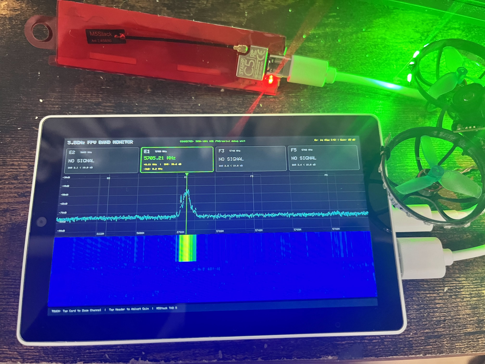

# M5Stack TAB 5 + ESP32-C5 (StampC5 / XIAO ESP32-C5) FPV 5.8GHz Band Monitor

[日本語](#japanese) | [English](#english)



---

<a name="japanese"></a>
## 日本語 (Japanese)

**M5Stack TAB 5** (ESP32-P4) の 5インチ 720p（1280×720）IPS ディスプレイで、FPV ドローン用 5.8GHz 帯の電波（FM-ATV）をリアルタイムに監視する携帯型バンドモニターシステムです。
PC 向け実装（[fpv-band-monitor-c5](https://github.com/zubon2003/fpv-band-monitor-c5)）と同等の機能を TAB 5 単体で実現します。

### 主な特徴

- **4波同時監視**: 既定で **E2 (5665 MHz) / E1 (5705 MHz) / F3 (5740 MHz) / F5 (5780 MHz)** を監視
- **リアルタイム UI (1280×720)**:
  - **4CH ステータスカード**: 実測中心周波数（電力加重重心法）、公称周波数からのオフセット、SNR、-3dB 占有帯域幅、在/無判定
  - **スペクトラム折れ線グラフ**: 9MHz / 17MHz 帯域枠、ノイズフロア基準線、重心周波数マーカー
  - **ウォーターフォール**: 時間経過に伴うカラーヒートマップ（青 → 緑 → 黄 → 赤）。新しいスイープデータと完全同期スクロール
- **タッチ操作対応**:
  - チャンネルカードをタップして「4CH 全体表示 ⇔ 1CH 拡大ズーム (20MHzスパン)」をワンタッチ切替
  - ヘッダー右端の `+` / `-` ボタンで SDR アナログゲインを即座に増減
- **ケーブル 1 本で直結**:
  - TAB 5 の **USB-A Host ポート** から ESP32-C5 モジュールに 5V 給電し、USB CDC-ACM 仮想シリアルで高速通信
- **Widscan58 および公式 ESP-SDR の両対応（自動判別）**:
  - **Widscan58 ファームウェア（推奨）**: ESP32-C5 側で高速ホッピング（~4ms/hop）と FFT・メトリクス計算を実行し、約 50〜60 rotations/s の高速かつ滑らかなリアルタイム表示を実現します。
  - **公式 ESP-SDR ファームウェア**: 生 I/Q データを USB 転送し、8192点 FFT・スティッチング・信号解析・UI描画をすべて TAB 5 (ESP32-P4 @ 400MHz) 側で実行します。
  - （実験的サポート）FPV-LCD カスタムファームウェア（SWEEP ストリーム転送）接続時にも自動判別して動作可能です。
  - ※ 接続時にプロトコルを自動判別するため、設定変更なしでどちらのファームウェアでも動作します。

### 対応ハードウェア

- **メインユニット**:
  - **M5Stack TAB 5** (ESP32-P4 + 32MB PSRAM + 5インチ 1280×720 MIPI-DSI ディスプレイ)
- **SDR 受信フロントエンド (以下のいずれかで動作確認済み)**:
  - **M5Stack StampC5** (ESP32-C5)
  - **Seeed Studio XIAO ESP32-C5**

### ESP32-C5 ファームウェアの準備

ESP32-C5 モジュール（StampC5 または XIAO ESP32-C5）には、**Widscan58** または **公式 ESP-SDR** ファームウェアを書き込みます。

#### オプション A: Widscan58 ファームウェア（推奨：高速応答 50〜60 fps）
1. ブラウザで **[Widscan58 Web UI (https://capnbry.github.io/widscan58/)](https://capnbry.github.io/widscan58/)** を開きます。
2. ESP32-C5 を PC に USB 接続します。
3. **Flash device** をクリックしてファームウェアをブラウザから直接書き込みます。

#### オプション B: 公式 ESP-SDR ファームウェア
1. ブラウザで **[ESP-SDR 公式サイト (https://espargos.net/espsdr/)](https://espargos.net/espsdr/)** を開きます。
2. ESP32-C5 を PC に USB 接続します。
3. サイト上の Web インストーラを使用し、**公式 ESP-SDR ファームウェア** を書き込みます。

### ハードウェア接続と役割分担

```
+------------------------------------+           USB-A to Type-C ケーブル           +---------------------------+
|          M5Stack TAB 5             | -------------------------------------------> |  StampC5 / XIAO ESP32-C5  |
|  (ESP32-P4 USB Host Controller)    | <==========================================> |   (ESP32-C5 Native USB)   |
|                                    |       [5V 給電] + [CDC-ACM 仮想シリアル]      |  Widscan58 / ESP-SDR FW   |
+------------------------------------+                                              +---------------------------+
```

1. M5Stack TAB 5 の **USB-A ポート** と ESP32-C5 モジュールの **Type-C ポート** を市販の USB ケーブルで接続します。
2. ESP32-C5 への電源は TAB 5 から供給されます（TAB 5 単体または NP-F550 バッテリー運用でも動作可能）。
3. TAB 5 の書き込み・デバッグログ確認は、TAB 5 の **USB-C ポート** を PC に接続して行います（USB-A と USB-C は同時利用可能）。

| デバイス | 担当機能 | 備考 |
| :--- | :--- | :--- |
| **StampC5 / XIAO ESP32-C5** | 5GHz RF チューニング、アナログゲイン設定、生 I/Q サンプリング（80MS/s, 8192点）、USB 送信 | 公式 ESP-SDR ファームウェア利用。改造不要 |
| **M5Stack TAB 5 (ESP32-P4)** | USB CDC-ACM ホスト制御、ホッピング計画、リアルタイム FFT (8192点)、Min スティッチング、電力加重重心法・SNR解析、1280x720 画面描画、タッチ操作 | 400MHz RISC-V デュアルコア + MIPI-DSI 液晶 + 32MB PSRAM |

### 開発環境とビルド手順

#### 必要な環境
- **VSCode** + **PlatformIO IDE** 拡張機能
- Platform: `pioarduino/platform-espressif32` (ESP-IDF v5.x / Arduino ESP32 v3.x, ESP32-P4 対応)

#### ビルドと書き込み
```bash
# ビルド
pio run

# 書き込み (TAB 5 の USB-C ポートを PC に接続)
pio run --target upload

# シリアルモニター確認 (115200 bps)
pio run --target monitor
```

#### Mac 上でのコアロジック単体テスト (CMake)
```bash
cd core
cmake -B build
cmake --build build
./build/test_vtxmon_core
```

---

<a name="english"></a>
## English

A standalone, portable 5.8GHz FPV analog video (FM-ATV) band monitor running on the **M5Stack TAB 5** (ESP32-P4) with a 5-inch 720p (1280×720) IPS touchscreen display.
It brings the full capabilities of the PC-based [fpv-band-monitor-c5](https://github.com/zubon2003/fpv-band-monitor-c5) into a single compact handheld unit.

### Key Features

- **Simultaneous 4-Channel Monitoring**: Default channels are **E2 (5665 MHz) / E1 (5705 MHz) / F3 (5740 MHz) / F5 (5780 MHz)**
- **Real-Time 1280×720 UI**:
  - **4-Channel Status Cards**: Measured center frequency (power-weighted centroid), offset from nominal frequency, SNR, -3dB occupied bandwidth, and signal presence
  - **Spectrum Line Graph**: 9MHz / 17MHz channel bandwidth bounds, noise floor line, and center frequency markers
  - **Waterfall Display**: Time-history heat map (blue → green → yellow → red), perfectly synchronized with real-time sweep frame updates
- **Capacitive Touch Controls**:
  - Tap any channel card to toggle between "ALL (4CH view)" and "1-Channel Zoom (20MHz span)"
  - Tap `+` / `-` buttons on the header to adjust SDR analog gain in real time
- **Single-Cable Connection**:
  - Connected directly from TAB 5's **USB-A Host port** to the ESP32-C5 module via a standard USB-A to Type-C cable, supplying 5V power and high-speed CDC-ACM virtual serial communication
- **Official ESP-SDR Firmware is Required**:
  - The ESP32-C5 module must be flashed with the official ESP-SDR firmware. It streams raw I/Q data over USB, and all 8192-point FFT, stitching, signal analysis, and UI rendering are computed on the TAB 5 (ESP32-P4 dual-core @ 400MHz).
  - *(Experimental)* Automatically detects and supports FPV-LCD custom firmware (SWEEP stream mode). For details on the LCD firmware, please refer to [https://github.com/zubon2003/fpv-band-monitor-c5](https://github.com/zubon2003/fpv-band-monitor-c5).

### Supported Hardware

- **Main Unit**:
  - **M5Stack TAB 5** (ESP32-P4 + 32MB PSRAM + 5" 1280×720 MIPI-DSI IPS display)
- **SDR Frontend Modules (Tested & Verified)**:
  - **M5Stack StampC5** (ESP32-C5)
  - **Seeed Studio XIAO ESP32-C5**

### ESP32-C5 Firmware Flashing (Required)

To use an ESP32-C5 module (StampC5 or XIAO ESP32-C5) with this project, you must flash the **ESP-SDR** firmware onto the module beforehand:

1. Open **[ESP-SDR Official Site (https://espargos.net/espsdr/)](https://espargos.net/espsdr/)** using a WebSerial-compatible browser (e.g., Google Chrome).
2. Connect your ESP32-C5 module to your PC via USB (you may need to hold the Boot button while connecting to enter download mode).
3. Use the online Web Flasher to flash the **official ESP-SDR firmware**.
   > **Note**: Do **not** use custom firmware that performs FFT on the ESP32-C5. Use the standard official ESP-SDR firmware (raw I/Q capture mode). All FFT and stitching computation is performed by the high-performance ESP32-P4 processor on TAB 5.  
   > *Note: For experimental FPV-LCD firmware support, please refer to [https://github.com/zubon2003/fpv-band-monitor-c5](https://github.com/zubon2003/fpv-band-monitor-c5).*

### Hardware Connection & Architecture

```
+------------------------------------+           USB-A to Type-C Cable              +---------------------------+
|          M5Stack TAB 5             | -------------------------------------------> |  StampC5 / XIAO ESP32-C5  |
|  (ESP32-P4 USB Host Controller)    | <==========================================> |   (ESP32-C5 Native USB)   |
|                                    |       [5V Power] + [CDC-ACM Virtual Serial]  |  ESP-SDR Official Firmware|
+------------------------------------+                                              +---------------------------+
```

1. Connect the **USB-A port** of M5Stack TAB 5 to the **Type-C port** of StampC5 / XIAO ESP32-C5 using a short USB cable.
2. The ESP32-C5 module is powered directly from TAB 5 (works portable on battery / NP-F550 battery).
3. Flashing and debug monitoring for TAB 5 is done via its **USB-C port** connected to your PC (both USB-A and USB-C can be used simultaneously).

| Component | Responsibility | Note |
| :--- | :--- | :--- |
| **StampC5 / XIAO ESP32-C5** | 5GHz RF tuning, analog gain control, raw I/Q sampling (80 MS/s, 8192 samples), USB streaming | Official ESP-SDR firmware. No modification required |
| **M5Stack TAB 5 (ESP32-P4)** | USB CDC-ACM host, LO hopping sequence, real-time 8192-point FFT, Min stitching, centroid & SNR analysis, 1280x720 UI rendering, touch handling | 400MHz RISC-V dual core + MIPI-DSI LCD + 32MB PSRAM |

### Building and Flashing

#### Prerequisites
- **VSCode** with **PlatformIO IDE** extension installed
- Platform: `pioarduino/platform-espressif32` (ESP-IDF v5.x / Arduino ESP32 v3.x with ESP32-P4 support)

#### Commands
```bash
# Build firmware
pio run

# Flash to TAB 5 (connect TAB 5 USB-C port to PC)
pio run --target upload

# Open Serial Monitor (115200 bps)
pio run --target monitor
```

#### Run Core DSP Tests on Mac (CMake)
```bash
cd core
cmake -B build
cmake --build build
./build/test_vtxmon_core
```

---

## License

MIT License. See [LICENSE](LICENSE) for details.
